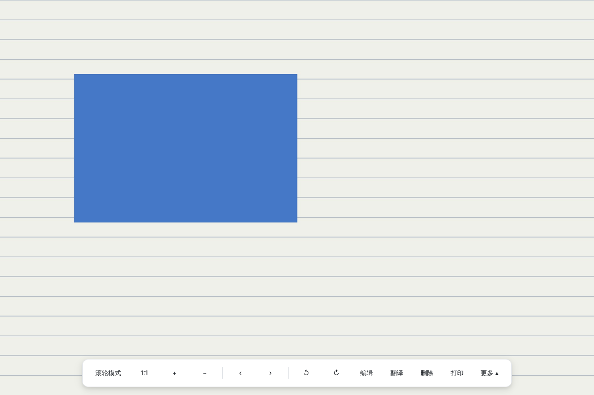
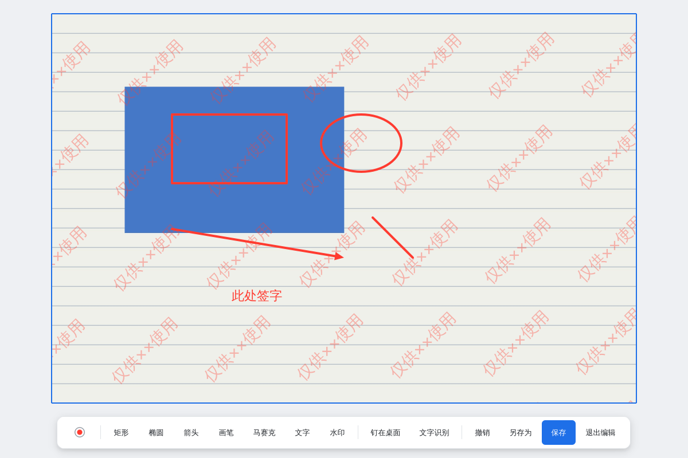
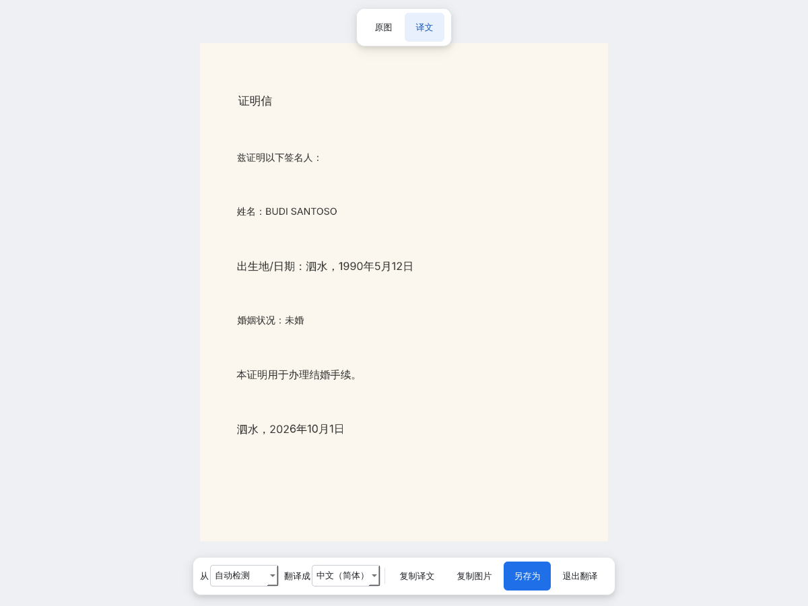

# 审哥看图王

免费、开源、无广告的 Windows 看图工具。操作习惯参照 2345看图王，但**不弹广告、不捆绑软件、不抢默认程序**。



## 功能

**看图**
- 双击图片秒开，同文件夹内翻页：A / W / ↑ / ← 上一张，D / S / ↓ / → / 空格 下一张
- 滚轮缩放、拖动、1:1、适应窗口、全屏（双击）
- 滚轮模式：看长图时滚轮上下移动，到头自动翻页
- 底部工具栏平时隐藏，鼠标移到窗口底部才出现
- 缩略图条、鸟瞰图、锁定缩放比、幻灯片（多种过渡效果）
- 浏览完一个文件夹可自动进入下一个文件夹
- 白色界面

**编辑**（按 E）
- 矩形、椭圆、箭头、画笔、马赛克、文字、可调颜色和粗细
- 水印：文字、颜色、不透明度、字号、角度可调，整图平铺
- 钉在桌面、离线文字识别（RapidOCR）
- 保存时按原图分辨率输出



**图片翻译**（按 T）
- 识别图片里的外文，用谷歌翻译后**直接在图里替换成中文**
- 原图 / 译文切换，按住空格临时看原图
- 支持中、英、印尼、马来、日、韩、泰、越等语言



**其他**
- 右键菜单：高级打印、复制、另存为、删除到回收站、裁剪、格式转换（带预估大小）、修改尺寸（可批量）、重命名、设为桌面背景、用其他软件打开、图片信息（EXIF）
- 旋转可直接保存到原图
- 设置项和 2345看图王 基本一致

## 支持的格式

JPG、PNG、GIF、BMP、TIF、WEBP、HEIC、AVIF、ICO、SVG、PSD、TGA、PCX、PCD、RAS、SGI、DDS、XBM、XPM、PNM、PFM、HDR、EXR、JP2、J2K、JPC、JNG、MNG、KOA、IFF、CUT、G3、PCT、WAP、WDP、WMF、AI、OFD，以及 CR2、NEF、ARW、DNG 等相机 RAW 格式。

## 下载使用

到 [Releases](../../releases) 下载打包好的压缩包，解压后运行 `ShenGeKanTu.exe`。

设为默认看图软件：右键 → 设置 → 文件关联 → 点“把勾选的格式设为用本软件打开…”，在弹出的 Windows“默认应用”里选“审哥看图王”。

按 F1 查看完整使用说明。

## 自己打包

需要 64 位 Python 3.10 以上。

```bat
git clone https://github.com/liangzaimo/ShenGeKanTu.git
cd ShenGeKanTu
build.bat
```

打包结果在 `dist\ShenGeKanTu\`。打包时会自动下载 FreeImage.dll，用来打开冷门格式；下载失败不影响其他功能。

图片翻译需要能访问谷歌：开启系统代理，或在 设置 → 习惯设置 里填写代理地址。

## 用到的开源项目

[PySide6](https://doc.qt.io/qtforpython/)（LGPL）· [Pillow](https://python-pillow.org/) · [pillow-heif](https://github.com/bigcat88/pillow_heif) · [rawpy](https://github.com/letmaik/rawpy) · [FreeImage](https://freeimage.sourceforge.io/)（GPL / FIPL）· [PyMuPDF](https://github.com/pymupdf/PyMuPDF)（AGPL）· [easyofd](https://github.com/renoyuan/easyofd) · [RapidOCR](https://github.com/RapidAI/RapidOCR) · [OpenCV](https://opencv.org/)

## 许可证

[AGPL-3.0](LICENSE)

本项目与 2345 公司无关，不包含 2345看图王的任何代码或素材。
